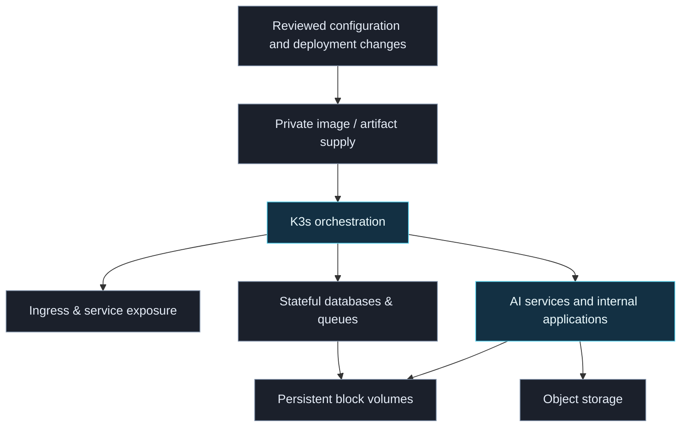
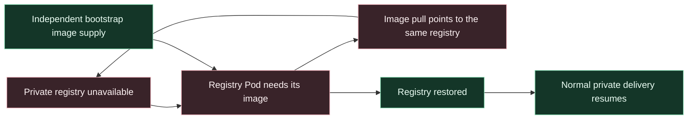
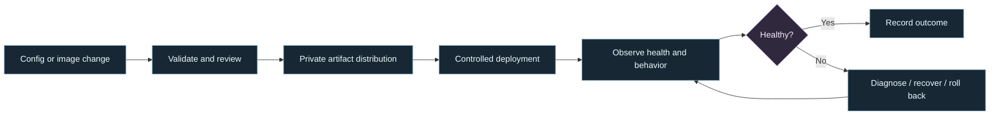

> **Role and scope:** Since my unit assignment in July 2025, I have been responsible for independently building, operating, and troubleshooting an on-premises K3s platform for AI systems in the Republic of Korea Air Force (ROKAF). I received the **ROKAF Chief of Staff Award in July 2026** in recognition of my work. This is an account of **engineering decisions and lessons learned**, not a publication of the unit's system design, physical topology, security configuration, or internal procedures.

  

Sole platform owner

Design, deployment, operations, recovery

  

Jul 2025–Present

ROKAF · AI systems infrastructure

  

Chief of Staff Award

ROKAF · Jul 2026

## Starting point: turn isolated services into a platform

The environment was an **on-premises, restricted-network infrastructure** serving AI-related systems. Individual Docker-hosted services were useful, but they made each deployment, recovery, and resource decision dependent on the service's particular host and operating procedure.

I wanted a more consistent answer to a few recurring questions:

- Where should a workload run, and what happens when its node becomes unavailable?
- How are images and packages delivered when external registries are not available?
- How can a stateful service recover when its persistent volume is tied to storage elsewhere?
- How do operational changes stay reproducible without managed cloud services?
- How do shared GPU resources fit into an infrastructure that also runs databases and internal services?

I chose **K3s** as the orchestration layer and gradually moved suitable workloads toward a common operating model. The objective was not Kubernetes for its own sake: it was to reduce one-off recovery paths and make service behavior easier to understand.

## Platform responsibilities at a glance

| Layer | Engineering work |
| --- | --- |
| **Linux and orchestration** | Established the K3s environment, operated cluster services, and troubleshot control-plane and node-level failures. |
| **Image and artifact supply** | Set up private image/package distribution and worked through bootstrap dependencies in a disconnected environment. |
| **Networking and service exposure** | Managed Traefik-based application routing, service exposure, and internal TLS trust. |
| **Persistent storage** | Operated Longhorn volumes and MinIO object storage, including recovery, migrations, and storage lifecycle concerns. |
| **Applications and data** | Worked with stateful databases, service messaging, deployment automation, and workload-specific requirements. |
| **AI workloads** | Considered GPU resource allocation, placement, resilience, and the limits of degraded-capacity service. |

The diagram below is a **conceptual dependency map**, deliberately **not** an actual node, network, or security topology.

## The hardest constraint: recovering without an outside dependency

In a closed network, the image registry can itself become an **availability dependency**. For example, if a private registry is deployed inside Kubernetes but its own container image must be pulled from that same registry, restarting it can create a recovery deadlock.

One practical mitigation was to separate a **minimal bootstrap image source** from the regular artifact service. The fallback should contain only what is needed to restore essential platform components, rather than duplicate the full registry.

That distinction changes the recovery sequence: **restore the artifact supply first, then restore dependent services**. I documented the reasoning separately in my [registry bootstrap note](/notes/k3s-registry-bootstrap-nexus-self-dependency/).

## Stateful services: a restart is not necessarily a recovery

A key operational lesson was that **workload scheduling, data availability, and service readiness are different things**.

Kubernetes can move a Pod, but a stateful workload may still need a volume to be detached and reattached, replicas to reconcile, database state to recover, or a downstream dependency to return. Longhorn-based persistent volumes made these delays visible.

I had to reason about:

- **Failure detection and failover:** when the control plane recognizes a problem and when a healthy workload can be scheduled.
- **Volume availability:** detach/attach timing, storage-replica state, and the difference between a volume being present and useful.
- **Application recovery:** the time an application or database needs after it receives its storage.
- **Service recovery goals:** realistic downtime and RTO/RPO expectations rather than claiming zero downtime from replication alone.

I also troubleshot incidents involving **etcd instability/corruption, read-only disks, storage attachment and rebuild behavior, and cluster instability**. The value of those incidents was learning to separate the *observable symptom* from the *verified root cause*. I do not publish sensitive logs or infer a single universal cause from those symptoms.

## Networking: routing is a dependency graph too

Internal service exposure required coordinating multiple layers, each with its own failure modes:

| Concern | Practical question |
| --- | --- |
| **K3s Service** | Which healthy endpoints are selected for a workload? |
| **Traefik** | Which ingress entry point and route lead to that Service? |
| **Load balancing** | Which externally reachable endpoint presents the service? |
| **TLS** | Is the certificate trusted and does its SAN match the requested endpoint? |
| **Client** | Does the client actually reach the intended protocol and port? |

An error on one layer can look like a problem in another. For example, an HTTP route can work after TLS negotiation while the browser still sees the default certificate because **TLS certificate selection happens before HTTP routing**.

I recorded public, sanitized explanations in the [Traefik/MetalLB networking note](/notes/k3s-traefik-nodeport-metallb-vip/) and the [private registry TLS note](/notes/nexus3-https-registry-root-ca-ip-san-docker/). These are engineering explanations, not a disclosure of actual endpoints.

## Engineering process: from manual service handling to repeatable operations

My work was not one installation event. A platform becomes valuable only when changes and failures can be handled consistently.

Across that process I worked with private container delivery, configuration management, persistent applications, deployment workflows, and operational troubleshooting. This required an understanding of both **what the platform is meant to do** and **where it actually fails under constrained conditions**.

GPU workloads added another practical trade-off: on shared infrastructure, full-device placement and lower-capacity fallback can be more realistic than assuming that all accelerators are freely divisible or that failures have no performance consequences.

## What I would design differently with more time

Several decisions deserve explicit attention in future iterations:

1. **Recovery dependencies first.** A service cannot depend exclusively on itself to retrieve the files needed to boot.
2. **Separately measure availability layers.** Control-plane health, storage recovery, application readiness, and user-visible availability should not be collapsed into a single 'HA' label.
3. **Treat storage capacity as part of reliability.** Replication does not remove disk-capacity limits; recovery and rebuild operations need headroom.
4. **Make restoration paths testable.** Backups, snapshots, and rollback procedures are only useful if their prerequisites and actual behavior are understood.
5. **Publish only safe technical abstractions.** Architecture knowledge can be shared without publishing an organization's internal deployment layout.

## Why this matters to my next work

This role made operating systems and storage feel much less abstract. A distributed platform eventually runs into questions about **filesystems, memory, I/O latency, failure ordering, and persistent data recovery**. Those questions are a major reason I want to study systems software, storage, and memory more deeply at KAIST.

**Documentation boundary:** This public write-up intentionally omits the physical node count and placement, private addresses, network/security controls, credentials, exact cluster configuration, and operational recovery procedures. The diagrams are conceptual and are not to scale.

## Related technical notes

- [Breaking the K3s/Nexus registry bootstrap dependency](/notes/k3s-registry-bootstrap-nexus-self-dependency/)
- [Traefik, MetalLB, and service-exposure behavior](/notes/k3s-traefik-nodeport-metallb-vip/)
- [Root CA and certificate trust for a private registry](/notes/nexus3-https-registry-root-ca-ip-san-docker/)
- [K3s kubeconfig and multi-cluster access concepts](/notes/k3s-kubeconfig-kubectl-k9s/)
