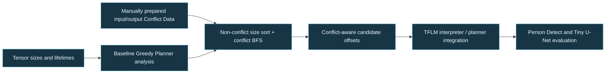

> **Project context:** Undergraduate work at Kyung Hee University, completed in 2024. This write-up reconstructs the design and evaluations from my original eight-page project report, *Memory Management through Lifecycle Analysis in TFLite Micro for Resource-Constrained Devices*. It describes what the report establishes, as well as what remained to be verified.

<div className="grid gap-4 border-y border-white/10 py-5 sm:grid-cols-3">
  <div><p className="text-2xl font-semibold text-white">28.33%</p><p className="mt-1 text-xs text-slate-400">Person Detect · peak memory saved</p></div>
  <div><p className="text-2xl font-semibold text-white">14.06%</p><p className="mt-1 text-xs text-slate-400">Tiny U-Net · peak memory saved</p></div>
  <div><p className="text-2xl font-semibold text-white">C++ / TFLM</p><p className="mt-1 text-xs text-slate-400">Planner design, integration, evaluation</p></div>
</div>

## Problem: tensor buffers still occupy memory after some of their data is no longer needed

TensorFlow Lite Micro (TFLM) targets inference on microcontrollers with small, fixed memory budgets. The runtime's **Greedy Memory Planner** already reuses memory when two temporary tensors have non-overlapping lifetimes. It is more efficient than simply giving every tensor a permanent buffer.

However, **non-overlapping lifetimes are not the only possible reuse opportunity**. During some operations, part of an input tensor may already have been consumed while the output is being produced. If the output can safely occupy that consumed region, the runtime need not reserve fully separate buffers for the entire duration of the operation.

The aim of this project was therefore not to replace the whole TFLM runtime, but to **change the placement rules for intermediate buffers** so they could exploit known input/output relationships.

## Baseline: how the Greedy Memory Planner works

I first analyzed the planner's behavior and printed each tensor's **size, offset, and lifetime** to understand the existing allocation decisions.

The planner receives buffer lifetimes through `AddBuffer()`. When offsets are needed, `GetOffsetForBuffer()` triggers `CalculateOffsetsIfNeeded()` to work out a shared-memory layout. The baseline broadly follows these steps:

1. Collect temporary buffers and their sizes and active intervals.
2. Order eligible buffers, generally preferring larger buffers.
3. Place each buffer at the lowest available offset that does not conflict with already placed buffers active at the same time.
4. Calculate the highest occupied byte, exposed through `GetMaximumMemorySize()`.

A time-lifetime conflict makes a memory-region overlap invalid in the baseline planner. That is usually a safe assumption, but it can be conservative when a producer and consumer support in-place reuse.

## Design: represent safe partial overlap explicitly

The key design input was **Conflict Data**, which records the input/output relationship and an allowable overlap boundary for a pair of tensors.

For an input buffer `A` and an output buffer `B`, the original report represents the relation as `{ A, B, -L }`. `L` captures a constraint on their relative placement, derived from the portion of input data that has already been consumed. The other boundary can be inferred from the input tensor's size, so it does not need to be stored separately.

The resulting idea is:

```text
Input tensor A:
[ already consumed | still needed for the operation ]
  ^ potentially reusable       ^ must stay intact

Output tensor B:
[ may be placed in an allowed overlap region ]
```

<figure>
  <a href="/figures/tflm-lifecycle-reuse.svg" target="_blank" rel="noopener noreferrer">
    
  </a>
  <figcaption>Figure 1. The allowable-overlap concept, redrawn for readability from the submitted capstone report's input/output conflict diagrams. Select to view larger.</figcaption>
</figure>

This is **not a claim that every convolution can overwrite its input**. The legal overlap is operator- and execution-order-dependent. The allocator is only allowed to reuse a region if the supplied Conflict Data says that placement is safe.

## Step 1: decide placement order using a conflict graph

The project kept the greedy planner's overall placement framework but divided temporary buffers into two groups.

**Buffers without Conflict Data** are considered first, ordered by size from largest to smallest. This retains the baseline heuristic for buffers that cannot use the special overlap rule.

**Buffers with Conflict Data** are ordered using a reverse, output-to-input graph traversal. For example, given relations `A → B`, `B → C`, `C → E`, and `D → E`, the terminal output `E` becomes the traversal root. A breadth-first traversal (BFS) places outputs before their inputs; when candidates have the same depth, larger buffers take priority.

<figure>
  <a href="/figures/tflm-conflict-bfs.svg" target="_blank" rel="noopener noreferrer">
    
  </a>
  <figcaption>Figure 2. Output-first, BFS-based buffer ordering, redrawn from the report's conflict graph; this is an allocation heuristic, not a proof of optimality.</figcaption>
</figure>

Why reverse the order? The planner searches from low memory offsets. If the output is already near the beginning of the arena, the subsequent input can be positioned relative to that output while respecting its allowed-overlap boundary.

## Step 2: extend candidate-offset calculation

The second change was to the buffer placement step. In the baseline, a simultaneously active buffer usually forces the next candidate offset **past the end of the existing buffer**.

The conflict-aware version checks whether the already placed buffer is an output tensor with a valid relation to the input currently being placed. When such a relation exists, it advances the candidate by the recorded conflict boundary rather than always adding the full output-buffer size.

Conceptually:

```text
Baseline:
  candidate offset = existing offset + existing buffer size

Conflict-aware pair:
  candidate offset = existing output offset + allowed conflict distance L

For unrelated or unsafe pairs:
  use the original non-overlapping placement rule
```

This is an **explanatory outline**, not copied production source code. The actual implementation still needs to check simultaneous lifetimes, neighboring allocations, available gaps, and the complete set of placement constraints.

## Step 3: integrate the planner into TFLM

I initially tested the algorithm on a manually constructed buffer set, comparing its offsets and highest memory address with the original Greedy Memory Planner.

I then adapted the planner and interpreter initialization so that a caller could provide an **array of Conflict Data and its count**. This allowed the planner to use supplied tensor relationships when constructing a layout for a TFLM model, without requiring each caller to hard-code offset calculations.

Importantly, the reported experiments used **manually calculated Conflict Data**, with that manual data preparation carried out by another team member. My primary work was analyzing the original planner, designing and implementing the conflict-aware ordering/placement logic in C++, integrating the modified planner into TFLM, and evaluating its peak-memory usage. Generating Conflict Data automatically through compiler profiling was a potential future extension, not a completed automatic pipeline.

## End-to-end planner workflow



## Evaluation

All figures below are **planned peak buffer usage**, not a measured reduction in MCU inference latency, energy consumption, or the complete firmware memory footprint.

| Evaluation | Greedy baseline | Conflict-aware planner | Reduction reported in the project |
| --- | ---: | ---: | ---: |
| Constructed buffer test | 4,101 bytes | 3,585 bytes | 12.58% |
| TFLM Person Detect | 55,296 bytes | 39,636 bytes | 28.33% |
| Tiny U-Net | 230,416 bytes | 198,120 bytes | 14.06% |

The constructed-buffer case confirmed that the planned overlaps occurred in the intended positions. The two TFLM models showed that the same strategy could reduce the maximum allocated offset in more realistic graphs, with larger savings on Person Detect than on Tiny U-Net.

*Reporting note:* The original report quotes **28.33%** and **14.06%** for the model-level reductions. Computing percentages directly from the byte counts printed in the same report gives approximately **28.32%** and **14.02%**; the small discrepancy is preserved here rather than silently altering either set of source figures.

## Limitations and lessons learned

The most important remaining step is **end-to-end correctness validation**. A planner can produce a smaller arena on paper but still corrupt an input if the assumed consumption order is wrong. The original report explicitly identified the need to check that inference results match those of the baseline after applying true in-place updates.

There are also two optimization limitations:

- The experiments used **manually supplied** conflict relationships. Generalizing this requires automatic, reliable operator-level profiling or analysis.
- Reverse BFS is a heuristic, not proof of an optimal allocation. A future planner could evaluate candidate placements by their effect on global peak memory rather than relying only on traversal order.

This project was valuable because it connected **operator execution order, data lifetime, and allocator behavior**. The size of a buffer is only one part of memory management; the more interesting question is **which bytes still contain data that future operations must read**.

## Source and references

- Primary source: my undergraduate project report, *Memory Management through Lifecycle Analysis in TFLite Micro for Resource-Constrained Devices* (Kyung Hee University, 2024). The report's figures and buffer logs informed this reconstruction; the original document is not hosted here.
- R. David et al., *TensorFlow Lite Micro: Embedded Machine Learning on TinyML Systems* (2021), [arXiv:2010.08678](https://arxiv.org/abs/2010.08678).
- [TensorFlow Lite Micro source project](https://github.com/tensorflow/tflite-micro).

*The work described here was completed during my undergraduate studies, before joining KAIST. It is not presented as a current OS Lab research result.*
